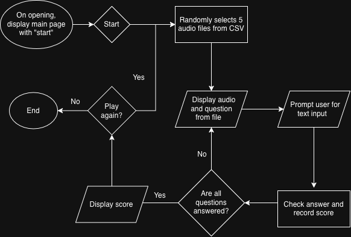

# Bird Song Quiz

Each round contains 5 bird song questions where the program 
selects an audio file and prompts the user for text input.

## The Problem

I want to help people improve their skills at identifying bird calls. 
There are amazing bioacoustic libraries yet few bird song quizzes available.

## How It Works

- Program randomly selects 5 audio files and generates questions
- Each question has a button to play audio and a box for text input
- After each question, the program displays an answer and records score
- Once the fifth question is answered, the players score will appear on screen
  with an option to play again or close




## Tech Stack

- **Language:** Java
- **Libraries:** BufferedReader, PrintWriter
- **External tools:** JavaFX, Cornell Audio Library

```bash
git clone https://github.com/peytonh60/bird-song-quiz
cd bird-song-quiz
./install.sh 
```

```bash
./backup.sh ~/Documents
```

## Roadmap

- [ ] Display bird image with answer
- [ ] Expand downloaded library to feature more birds
- [ ] Summarize game data over multiple rounds

## Author

Peyton Holloway, https://github.com/peytonh60/