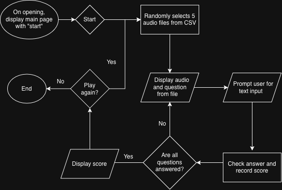

# Bird Song Quiz

Each round contains 5 bird song questions where the program 
selects an audio file and prompts the user for text input.

## The Problem

I want to help people improve their skills at identifying bird calls. 
There are amazing bioacoustic libraries yet few bird song quizzes available.

## How It Works

- Program randomly selects 5 audio files and generates questions
- Each question has a button to play audio and a box for text input
- After each question, the program displays an answer and records score
- Once the fifth question is answered, the score will appear on screen
  with an option to play again




## Tech Stack

- **Language:** Java
- **Libraries:** JLayer, Swing, BufferedReader, FileReader, BufferedInputStream, FileInputStream
- **External tools:** Cornell Audio Library

## Setup

This program was created using IntelliJ. I recommend using a text editor to install.

```bash
git clone https://github.com/peytonh60/bird-song-quiz
cd bird-song-quiz
```

## Usage

Open in a text editor like IntelliJ or VS Code and select the run button.

```bash
open src/Main.java
```

A window opens with the frame title "Bird Song Quiz" 

1. The program opens with "Start Quiz" option
2. Each question has a button to play song audio
3. The user can type or select a guess in the response box
4. The submit button scores the question and provides feedback for a correct/incorrect answer
5. At the end, the program prints total score with an option to "Play Again"

## Roadmap

- [ ] Display bird image with answer
- [x] Print the question number on each slide
- [ ] Submit bird name guess with ENTER key
- [ ] Connect to bird API

## Demo

Link to demo: https://youtu.be/u-m7sLRSC9U

## Author

Peyton Holloway, https://github.com/peytonh60/